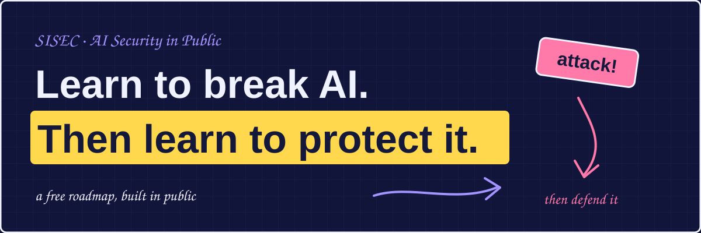
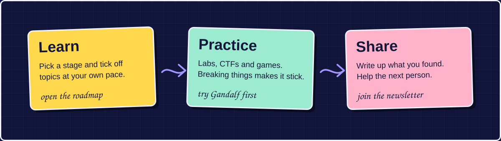
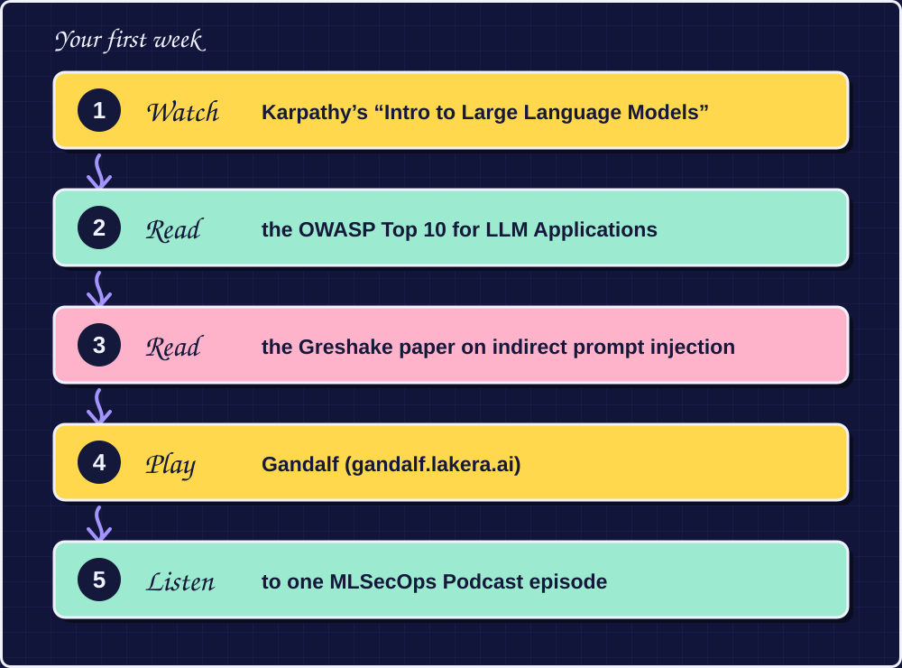
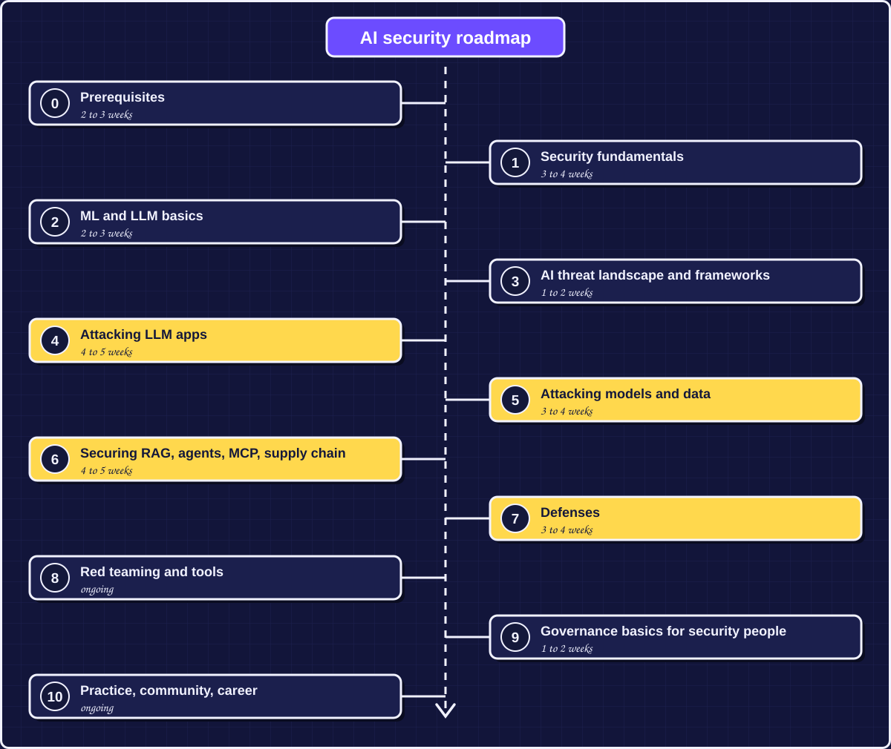

<p align="center">
  
</p>

<p align="center">
  
  
  
</p>

# Hey friends! 👋

I'm **Laiba**, an AI security researcher, and this repo is where I learn AI security **in public**.

It is the home of the **SISEC roadmap**: a free, step-by-step path from zero to a solid AI security foundation. You'll learn how LLMs work, how AI systems get attacked, how to defend them, and how to test them.

SISEC is a free, volunteer-run, non-profit community for anyone curious about AI security: students, engineers, researchers and total beginners.

<p align="center"></p>


<p align="center"></p>

## ✏️ Start here

Short on time? Do your first week like this, in order:

<p align="center"></p>


Then open the full roadmap and go from Stage 0.

<p align="center"></p>

## 🗺️ The roadmap

Part-time (about 5 to 8 hours a week), the whole thing takes **5 to 6 months**. Skip any stage you already know.

<p align="center"></p>

<details>
<summary>Prefer plain text? Open the table</summary>

| Stage | Topic | Time |
|:--:|---|---|
| 0 | Prerequisites | 2 to 3 weeks |
| 1 | Security fundamentals | 3 to 4 weeks |
| 2 | ML and LLM basics | 2 to 3 weeks |
| 3 | AI threat landscape and frameworks | 1 to 2 weeks |
| 4 | Attacking LLM apps | 4 to 5 weeks |
| 5 | Attacking models and data | 3 to 4 weeks |
| 6 | Securing RAG, agents, MCP and supply chain | 4 to 5 weeks |
| 7 | Defenses | 3 to 4 weeks |
| 8 | Red teaming and tools | ongoing |
| 9 | Governance basics for security people | 1 to 2 weeks |
| 10 | Practice, community, career | ongoing |

</details>

**How to use it:** go in order, tick boxes as you finish, and do the hands-on task at the end of each stage. Every stage ends with a **checkpoint**, a small task that proves you got it.

👉 **Read it here:** [`roadmap.md`](ROADMAP.md)
👉 **Prefer a clickable chart?** Visit the SISEC website *(link coming soon)*. It draws this same roadmap, saves your progress, and updates whenever this repo changes.

<p align="center"></p>

## 📬 Newsletter

New attacks, defenses and research, explained in plain words. One email, no spam.

*(Link coming soon.)*

## 💬 Community

Come hang out, ask questions, share what you're building, or just lurk and read.

*(Invite link coming soon.)*

<p align="center"></p>

## 📁 What's in this repo

```
ai-security-in-public/
├── README.md        ← you are here
├── ROADMAP.md       ← the full roadmap, easy to read on GitHub
├── roadmap.json     ← the same roadmap as data; the website reads this file
└── assets/          ← the doodle graphics used in this README
```

> **Heads up:** the website draws its chart from `roadmap.json`. Whenever `ROADMAP.md` changes, update `roadmap.json` too so they match.

<p align="center"></p>

## 🙌 Contributing

Found a broken link, a better resource, or a missing topic? Please help.

1. Open an **issue** to discuss an idea, or
2. Open a **pull request** with your fix.

A few small rules:

- Keep everything **free**. If a resource costs money, it doesn't belong here.
- Add a one-line reason for each new resource, so beginners know why it's good.
- In `roadmap.json`, **never change a topic's `id`**. Visitors' saved progress is stored by id.
- Websites change. If a link is dead, say so in an issue.


## ⚠️ A note on links

Websites move and change. Please check that a link opens before you share it. Items marked "search by title" in the roadmap are best found with a quick search.

<p align="center"></p>

<p align="center">
  Built in public, with ❤️ by <b>Laiba</b> and the <b>SISEC</b> community.<br>
  <i>Learn to break AI. Then learn to protect it.</i>
</p>
