

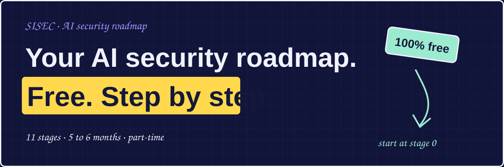

  
  
  

# Hey friends! 👋

This roadmap takes you from zero to a solid AI security foundation: how LLMs work, how AI systems get attacked, how to defend them, and how to test them. Everything here is free.

> **How to use this page:** go in order, tick boxes as you finish, and do the hands-on task at the end of each stage.
>
> **Pace:** part-time, about 5 to 8 hours a week, is about 5 to 6 months for the whole roadmap. Skip any stage you already know.

## 🧭 The journey

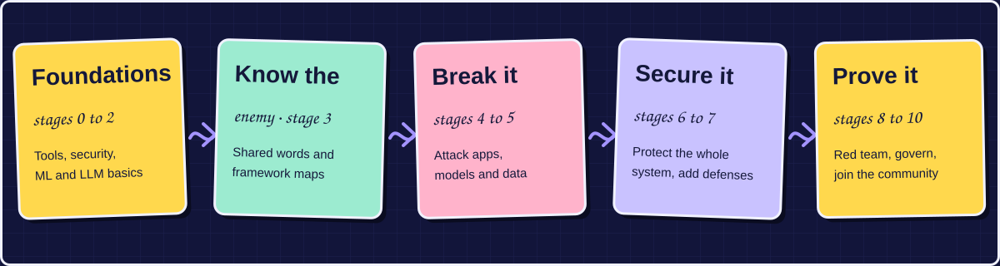

| Stage | Topic | Time |
|:--:|---|---|
| [0](#stage-0) | [Prerequisites](#stage-0) | 2 to 3 weeks |
| [1](#stage-1) | [Security fundamentals](#stage-1) | 3 to 4 weeks |
| [2](#stage-2) | [ML and LLM basics](#stage-2) | 2 to 3 weeks |
| [3](#stage-3) | [AI threat landscape and frameworks](#stage-3) | 1 to 2 weeks |
| [4](#stage-4) | [Attacking LLM apps](#stage-4) | 4 to 5 weeks |
| [5](#stage-5) | [Attacking models and data](#stage-5) | 3 to 4 weeks |
| [6](#stage-6) | [Securing RAG, agents, MCP and supply chain](#stage-6) | 4 to 5 weeks |
| [7](#stage-7) | [Defenses](#stage-7) | 3 to 4 weeks |
| [8](#stage-8) | [Red teaming and tools](#stage-8) | ongoing |
| [9](#stage-9) | [Governance basics for security people](#stage-9) | 1 to 2 weeks |
| [10](#stage-10) | [Practice, community, career](#stage-10) | ongoing |

<h2 align="center"></h2>

> 🎯 **Goal:** have the tools to follow everything that comes later.

### ✏️ Learn

- [ ] Python basics (variables, functions, loops, APIs with `requests`)
- [ ] Linux command line
- [ ] Networking basics (IP, DNS, HTTP, TLS)
- [ ] How web apps and REST APIs work (requests, headers, JSON, auth tokens)
- [ ] Git and GitHub basics

### 📚 Free resources

- [ ] Python: search YouTube for "Python for beginners" (freeCodeCamp) or the free Automate the Boring Stuff book · [🔗 automatetheboringstuff.com](https://automatetheboringstuff.com)
- [ ] Linux: OverTheWire "Bandit" wargame · [🔗 overthewire.org](https://overthewire.org)
- [ ] Networking: search YouTube for "Professor Messer Network+" (free full course)

> ✅ **Checkpoint:** you can write a Python script that calls an API and prints the JSON response.

<b>↓ next up: Stage 1, Security fundamentals</b> &nbsp;·&nbsp; <a href="#top">back to top ↑</a>

<h2 align="center">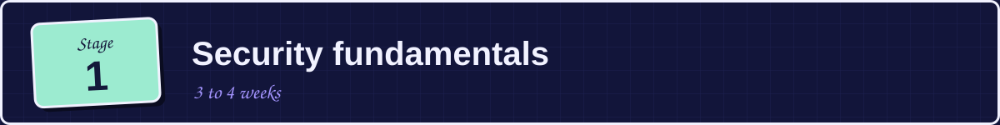</h2>

> 🎯 **Goal:** think like a defender before you think about AI. Most AI attacks are old security problems in a new setting.

### ✏️ Learn

- [ ] The CIA triad (confidentiality, integrity, availability)
- [ ] Threat modeling and attack surface
- [ ] Authentication vs authorization
- [ ] Least privilege and trust boundaries
- [ ] Injection attacks (SQL injection, XSS, command injection)
- [ ] OWASP Top 10 for web apps and APIs
- [ ] Secure software development basics

### 📚 Free resources

- [ ] PortSwigger Web Security Academy, free interactive labs · [🔗 portswigger.net/web-security](https://portswigger.net/web-security)
- [ ] Free book: Ross Anderson, *Security Engineering* (free chapters on his website)
- [ ] OWASP Top 10 · [🔗 owasp.org](https://owasp.org)
- [ ] YouTube: LiveOverflow and John Hammond for beginner-friendly security walkthroughs
- [ ] Podcast: Darknet Diaries (real stories of hacks, good for building intuition)

> ✅ **Checkpoint:** draw a simple threat model for any web app you use.

<b>↓ next up: Stage 2, ML and LLM basics</b> &nbsp;·&nbsp; <a href="#top">back to top ↑</a>

<h2 align="center">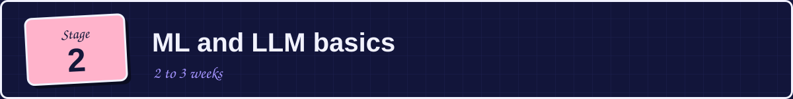</h2>

> 🎯 **Goal:** know just enough ML to understand how things break. You don't need a research-level background.

### ✏️ Learn

- [ ] What machine learning is (training, inference, datasets)
- [ ] Neural networks in plain words
- [ ] Tokens, embeddings, and the transformer
- [ ] Pretraining vs fine-tuning vs RLHF
- [ ] What system prompts, context windows, and tool calling are
- [ ] Why LLMs can't reliably separate instructions from data

### 📚 Free resources

- [ ] YouTube: Andrej Karpathy, "Intro to Large Language Models" (1 hour, includes a security section near the end)
- [ ] YouTube: Andrej Karpathy, "Deep Dive into LLMs like ChatGPT"
- [ ] YouTube: 3Blue1Brown, neural networks and transformers series
- [ ] Free book: *Dive into Deep Learning* · [🔗 d2l.ai](https://d2l.ai), early chapters
- [ ] Paper (skim): "Attention Is All You Need" · [🔗 arxiv.org/abs/1706.03762](https://arxiv.org/abs/1706.03762)

> ✅ **Checkpoint:** explain in plain words why a model that reads a webpage might follow instructions hidden in it.

<b>↓ next up: Stage 3, AI threat landscape and frameworks</b> &nbsp;·&nbsp; <a href="#top">back to top ↑</a>

<h2 align="center">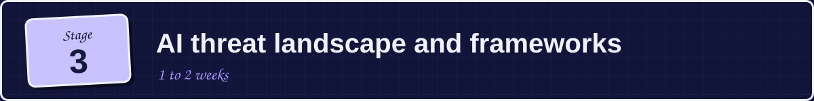</h2>

> 🎯 **Goal:** learn the shared vocabulary and the standard maps of AI threats.

### ✏️ Learn

- [ ] The difference between evasion, poisoning, privacy, and misuse attacks
- [ ] Attack stages across the ML lifecycle (data, training, deployment)
- [ ] The main frameworks and what each is for

### 📚 Free resources

- [ ] NIST AI 100-2e2025, "Adversarial Machine Learning: A Taxonomy and Terminology of Attacks and Mitigations" · [🔗 doi.org/10.6028/NIST.AI.100-2e2025](https://doi.org/10.6028/NIST.AI.100-2e2025). It classifies attacks by system type, lifecycle stage, attacker goals, capabilities, and knowledge. Use it as a reference and read the intro and glossary first.
- [ ] OWASP Top 10 for LLM Applications 2025 · [🔗 genai.owasp.org/llm-top-10/](https://genai.owasp.org/llm-top-10/)
- [ ] MITRE ATLAS, the attack-technique knowledge base for AI · [🔗 atlas.mitre.org](https://atlas.mitre.org)
- [ ] Google Secure AI Framework, SAIF · [🔗 saif.google](https://saif.google)
- [ ] NIST AI Risk Management Framework · [🔗 nist.gov](https://nist.gov/itl/ai-risk-management-framework)

> ✅ **Checkpoint:** pick any AI app and list which OWASP LLM Top 10 items apply to it.

<b>↓ next up: Stage 4, Attacking LLM applications</b> &nbsp;·&nbsp; <a href="#top">back to top ↑</a>

<h2 align="center">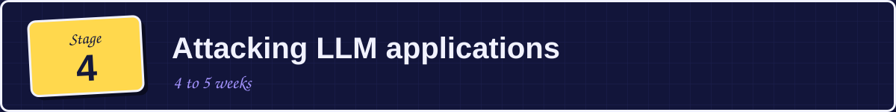</h2>

> 🎯 **Goal:** understand the most common real attacks on chatbots and LLM-powered apps.

### ✏️ Learn

- [ ] Direct prompt injection
- [ ] Indirect prompt injection (instructions hidden in documents, emails, web pages)
- [ ] Jailbreaking (roleplay, encoding tricks, multi-turn attacks)
- [ ] System prompt leakage
- [ ] Sensitive information disclosure
- [ ] Insecure output handling (model output reaching a browser, shell or database)
- [ ] Excessive agency (an LLM with too many permissions)
- [ ] Unbounded consumption (cost and denial-of-service attacks)
- [ ] Data exfiltration through rendered markdown and links

### 📚 Free resources

- [ ] Paper: Greshake et al., "Not what you've signed up for: Compromising Real-World LLM-Integrated Applications with Indirect Prompt Injection" · [🔗 arxiv.org/abs/2302.12173](https://arxiv.org/abs/2302.12173)
- [ ] Paper: "Universal and Transferable Adversarial Attacks on Aligned Language Models" · [🔗 arxiv.org/abs/2307.15043](https://arxiv.org/abs/2307.15043)
- [ ] Blog: Simon Willison on prompt injection · [🔗 simonwillison.net](https://simonwillison.net). Search for his post on the "lethal trifecta" for agents.
- [ ] PortSwigger Web LLM Attacks labs, free · [🔗 portswigger.net](https://portswigger.net/web-security/llm-attacks)
- [ ] Podcast: MLSecOps Podcast, "Beyond Prompt Injection: AI's Real Security Gaps"

### 🛠️ Hands-on

- [ ] Play Gandalf by Lakera · [🔗 gandalf.lakera.ai](https://gandalf.lakera.ai) all the way through
- [ ] Complete the PortSwigger Web LLM attack labs
- [ ] Try Tensor Trust · [🔗 tensortrust.ai](https://tensortrust.ai) or HackAPrompt-style challenges

> ✅ **Checkpoint:** explain the difference between direct and indirect prompt injection, and why indirect is harder to defend.

<b>↓ next up: Stage 5, Attacking models and data</b> &nbsp;·&nbsp; <a href="#top">back to top ↑</a>

<h2 align="center">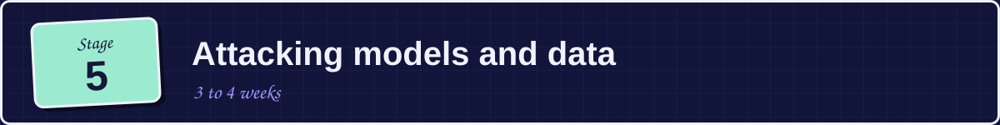</h2>

> 🎯 **Goal:** understand attacks that target the model itself and the data behind it.

### ✏️ Learn

- [ ] Adversarial examples and evasion attacks (fooling image or text classifiers)
- [ ] Data poisoning and backdoors
- [ ] Training data extraction
- [ ] Membership inference (was this record in the training set?)
- [ ] Model extraction and theft
- [ ] Model inversion

### 📚 Free resources

- [ ] Paper: Carlini et al., "Extracting Training Data from Large Language Models" · [🔗 arxiv.org/abs/2012.07805](https://arxiv.org/abs/2012.07805)
- [ ] NIST AI 100-2e2025 (sections on poisoning, evasion, and privacy attacks)
- [ ] Free tutorial: Adversarial Robustness, Theory and Practice by Kolter and Madry · [🔗 adversarial-ml-tutorial.org](https://adversarial-ml-tutorial.org)
- [ ] Open-source library: IBM Adversarial Robustness Toolbox · [🔗 github.com](https://github.com/Trusted-AI/adversarial-robustness-toolbox)

### 🛠️ Hands-on

- [ ] Use the Adversarial Robustness Toolbox to fool a small image classifier
- [ ] Try the Crucible AI security CTF by Dreadnode · [🔗 crucible.dreadnode.io](https://crucible.dreadnode.io)

> ✅ **Checkpoint:** explain how poisoning differs from evasion, with an example of each.

<b>↓ next up: Stage 6, Securing RAG, agents, MCP and the supply chain</b> &nbsp;·&nbsp; <a href="#top">back to top ↑</a>

<h2 align="center">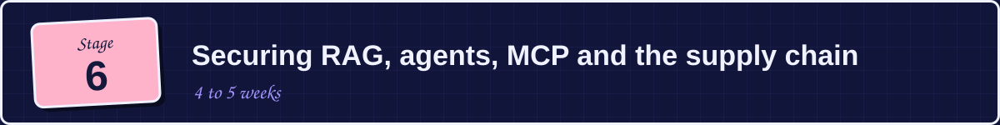</h2>

> 🎯 **Goal:** secure the whole system around the model, which is where most real incidents happen.

### ✏️ Learn

- [ ] RAG security (poisoned documents, access control on retrieval, vector database exposure)
- [ ] Agent security (tool permissions, confused deputy, chained actions)
- [ ] MCP and plugin security (malicious tools, tool poisoning, over-broad scopes)
- [ ] Supply chain risk (malicious models, unsafe pickle files, tampered datasets, compromised packages)
- [ ] API and infrastructure security for model endpoints (keys, rate limits, logging)
- [ ] SBOMs for AI (tracking models, datasets and dependencies)

### 📚 Free resources

- [ ] OWASP Top 10 for Agentic Applications · [🔗 genai.owasp.org](https://genai.owasp.org)
- [ ] Podcast: MLSecOps Podcast, "AI Security: Map It, Manage It, Master It"
- [ ] Podcast: MLSecOps Podcast, "Practical Foundations for Securing AI"
- [ ] Podcast: MLSecOps Podcast, "Unpacking the Cloud Security Alliance AI Controls Matrix"
- [ ] Hugging Face docs on safetensors vs pickle · [🔗 huggingface.co/docs](https://huggingface.co/docs)
- [ ] Bug bounty: huntr.com, a platform for AI and ML vulnerabilities

> ✅ **Checkpoint:** write a one-page security review of a RAG chatbot with tool access.

<b>↓ next up: Stage 7, Defenses</b> &nbsp;·&nbsp; <a href="#top">back to top ↑</a>

<h2 align="center">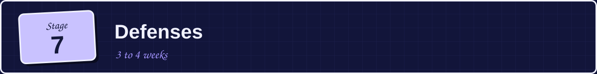</h2>

> 🎯 **Goal:** know what actually reduces risk, and what doesn't.

### ✏️ Learn

- [ ] Treat model output as untrusted input
- [ ] Least privilege for tools, data, and credentials
- [ ] Sandboxing and isolation for code execution
- [ ] Human approval for high-impact actions
- [ ] Input and output filtering (and its limits)
- [ ] Guardrails and content classifiers
- [ ] Rate limiting and cost controls
- [ ] Logging, monitoring, and incident response for AI systems
- [ ] MLSecOps: building security into the ML pipeline

> 💡 **Key idea:** there is no single fix for prompt injection, so design systems that stay safe even when the model is tricked.

### 📚 Free resources

- [ ] OWASP LLM Top 10 (read the mitigations for each item)
- [ ] Open source: LLM Guard by Protect AI · [🔗 github.com/protectai/llm-guard](https://github.com/protectai/llm-guard)
- [ ] Open source: NVIDIA NeMo Guardrails · [🔗 github.com/NVIDIA/NeMo-Guardrails](https://github.com/NVIDIA/NeMo-Guardrails)
- [ ] Open source: Llama Guard (search on Hugging Face)
- [ ] arXiv: search recent papers on indirect prompt injection defenses (this area moves fast)
- [ ] Podcast: MLSecOps Podcast, "Securing AI: The Role of People, Processes & Tools in MLSecOps"

> ✅ **Checkpoint:** take your Stage 6 review and add a defense for each risk you found.

<b>↓ next up: Stage 8, Red teaming and tools</b> &nbsp;·&nbsp; <a href="#top">back to top ↑</a>

<h2 align="center">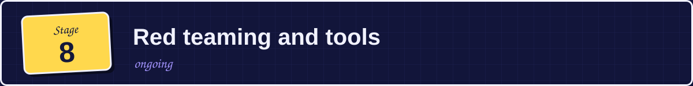</h2>

> 🎯 **Goal:** test AI systems systematically and report findings clearly.

### ✏️ Learn

- [ ] How AI red teaming differs from traditional pentesting
- [ ] Building attack datasets and automated test suites
- [ ] Measuring attack success rate
- [ ] Writing a clear finding (impact, reproduction steps, fix)

### 📚 Free resources

- [ ] Tool: garak, an LLM vulnerability scanner by NVIDIA · [🔗 github.com/NVIDIA/garak](https://github.com/NVIDIA/garak)
- [ ] Tool: PyRIT, Microsoft's red teaming framework · [🔗 github.com/Azure/PyRIT](https://github.com/Azure/PyRIT)
- [ ] Tool: promptfoo, test and red team LLM apps · [🔗 promptfoo.dev](https://promptfoo.dev)
- [ ] Paper: "Lessons From Red Teaming 100 Generative AI Products" by Microsoft (search by title)
- [ ] YouTube: Microsoft "AI Red Teaming 101" series (search by title)
- [ ] YouTube: DEF CON AI Village talks

### 🛠️ Hands-on

- [ ] Run garak against a small local model and read the report
- [ ] Red team a chatbot you build yourself and write up three findings

> ✅ **Checkpoint:** a written report with three reproducible findings.

<b>↓ next up: Stage 9, Governance basics for security people</b> &nbsp;·&nbsp; <a href="#top">back to top ↑</a>

<h2 align="center">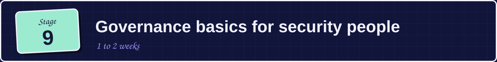</h2>

> 🎯 **Goal:** speak the language of risk and compliance without going deep into policy.

### ✏️ Learn

- [ ] AI risk assessment basics
- [ ] ISO/IEC 42001 and the NIST AI RMF at a high level
- [ ] The EU AI Act at a high level (security and robustness requirements)
- [ ] Data privacy basics (GDPR) for AI systems

### 📚 Free resources

- [ ] NIST AI RMF and its playbook
- [ ] CSA AI Controls Matrix · [🔗 cloudsecurityalliance.org](https://cloudsecurityalliance.org)
- [ ] Podcast: MLSecOps Podcast, "Secure AI Implementation and Governance"

<b>↓ next up: Stage 10, Practice, community, career</b> &nbsp;·&nbsp; <a href="#top">back to top ↑</a>

<h2 align="center">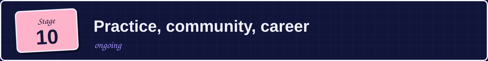</h2>

### ✏️ Learn

- [ ] Join the MLSecOps community (community.mlsecops.com)
- [ ] Join the OWASP GenAI Security Project community
- [ ] Follow DEF CON AI Village
- [ ] Start a public GitHub repo with your lab write-ups and red team reports
- [ ] Write one blog post a month explaining something you learned
- [ ] Try bug bounties on huntr.com

<b>↓ extras: podcasts, books and a quick start</b> &nbsp;·&nbsp; <a href="#top">back to top ↑</a>

## 🎁 Extras

### 🎧 Podcasts

- [ ] **The MLSecOps Podcast** by Protect AI, the main AI security podcast. Start with "Beyond Prompt Injection", "AI Security: Map It, Manage It, Master It", and "Practical Foundations for Securing AI"
- [ ] **Darknet Diaries**, general security stories
- [ ] **Practical AI**, general AI and ML background

### 📖 Free books and long reads

- [ ] NIST AI 100-2e2025 (Adversarial ML taxonomy)
- [ ] OWASP Top 10 for LLM Applications 2025
- [ ] Ross Anderson, *Security Engineering*
- [ ] *Dive into Deep Learning* · [🔗 d2l.ai](https://d2l.ai)
- [ ] Adversarial Robustness tutorial · [🔗 adversarial-ml-tutorial.org](https://adversarial-ml-tutorial.org)
- [ ] Automate the Boring Stuff with Python

### ⚡ Quick start: your first week

Short on time? Do these five, in order:

> **A note on links:** websites change. Check that each link opens before you share it. Items listed "by title" are best found with a quick search.

Built in public, with ❤️ by **Laiba** and the **SISEC** community.  
*Learn to break AI. Then learn to protect it.*
